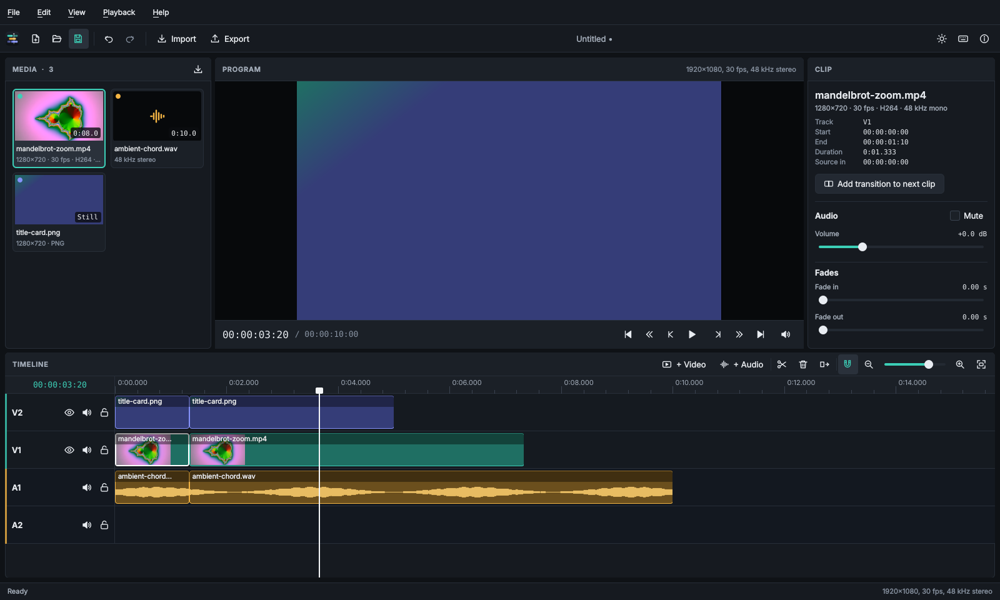

<p align="center">
  
</p>

<p align="center"><strong>A local-first, open-source desktop video editor for precise, multi-track editing.</strong></p>

<p align="center">
  <a href="https://github.com/sanskarIN/frametrellis/actions/workflows/ci.yml"></a>
  <a href="LICENSE"></a>
  <a href="https://sanskarin.github.io/frametrellis/"></a>
</p>

FrameTrellis is a desktop video editor built with C++20, Qt 6/QML and the MLT multimedia
framework (with FFmpeg underneath). Your footage never leaves your computer: there is no
account, no cloud processing, no telemetry and no advertising.



> **Latest stable release: 1.3.0.** Safer project saves and media identity,
> searchable media bin, Go to Timecode (Ctrl+G), and read-only project inspection.
> Download the verified Windows installer or portable ZIP from the
> [v1.3.0 release](https://github.com/sanskarIN/frametrellis/releases/tag/v1.3.0).
> On Linux, build from source. Back up important projects.


## Features

What works today (each item is implemented and covered by automated tests):

- [x] Create, open and save projects in a versioned, validated JSON format (`.ftproj`), with
      atomic saves that never damage the previous file
- [x] Import video, audio and still images (common formats FFmpeg can decode), probed in the
      background with real thumbnails; duplicate imports are detected
- [x] Missing-media detection with offline placeholders and relinking; projects resolve media
      relative to a moved project folder; duplicate canonical media paths are refused
- [x] Search and category-filter the media bin without removing any project assets
- [x] Multi-track timeline with any number of video and audio tracks (up to 99)
- [x] Drag media from the bin onto tracks, move clips (also between tracks), trim either edge,
      split at the playhead, delete and ripple delete — overlapping edits are refused, not destructive
- [x] Duplicate one or many selected clips with Ctrl+D; multi-clip copies retain their gaps and relative video/audio alignment in one undoable operation
- [x] Create transparent PNG title overlays with font size and colour choices, stored beside
      the saved project and editable on the timeline as ordinary image clips
- [x] Snapping to clip edges and the playhead, zoom, frame-accurate timecode (including
      drop-frame for 29.97/59.94 fps), and Go to Timecode (Ctrl+G)
- [x] Real-time preview with audio (SDL2), seeking, frame stepping and edit-point navigation
- [x] Track mute, hide and lock; clip volume, mute, fade in/out and opacity; batch mute/unmute,
      copy/paste clip attributes and reset picture adjustments for multi-selections
- [x] Real audio waveforms on audio clips, computed in the background and cached
- [x] Transitions between touching clips: a dissolve for the picture and a crossfade for the sound
- [x] Brightness, contrast and saturation per clip (when the FFmpeg `eq` filter is available)
- [x] Unlimited-style undo/redo (500 steps) for every edit, with slider drags merged into one step
- [x] Export to MP4 (H.264 + AAC) with Quick and Turbo profiles, no-upscale controls,
      real-time render frames/s, quality and encoder-speed settings, in a separate process
      with progress, cancellation and verification of the result
- [x] Read-only project inspection via `frametrellis-render --inspect-project --project FILE`,
      including media and track counts without revealing source paths
- [x] Autosave every minute and crash recovery
- [x] Recent projects, dark and light themes, keyboard shortcuts, first-run guide

Planned (see the [roadmap](docs/roadmap.md)): editable title layers, subtitles, keyframes,
proxy media, customisable shortcuts, more export formats, and Linux and macOS packages.

## Platforms

| Platform | Status |
|---|---|
| Windows 11 and Windows 10 1809 or later (x64) | Installer and portable ZIP. Before each release they are verified automatically on clean Windows Server 2022, Windows Server 2025 and Windows 11 (ARM64, x64 emulation) machines |
| Linux (x86-64) | Build from source; builds and tests run in CI on Ubuntu 24.04. No package yet |
| macOS | Not supported yet (planned) |

## Building

FrameTrellis needs a C++20 compiler, CMake ≥ 3.21, Qt ≥ 6.5 (Core, Gui, Qml, Quick, Quick
Controls, Svg, Concurrent, Test), MLT ≥ 7.14 with its FFmpeg (`avformat`) module, and optionally
SDL 2 for audio playback. Full instructions for Windows 11, Linux and macOS are in
[docs/development/building.md](docs/development/building.md).

Quick start on **Windows 11** (in an MSYS2 UCRT64 shell):

```sh
pacman -S --needed mingw-w64-ucrt-x86_64-{cc,cmake,ninja,pkgconf,qt6-base,qt6-declarative,qt6-svg,qt6-imageformats,mlt,fftw,libebur128,ffmpeg,SDL2}
cmake --preset windows-msys2
cmake --build --preset windows-msys2
ctest --preset windows-msys2
```

Quick start on **Ubuntu 24.04** (details in the building guide):

```sh
sudo apt install build-essential cmake ninja-build pkg-config git \
  libavformat-dev libavcodec-dev libavutil-dev libavfilter-dev libavdevice-dev \
  libswscale-dev libswresample-dev libsdl2-dev libgl1-mesa-dev libxkbcommon-x11-0 libxcb-cursor0
pipx install aqtinstall                      # Ubuntu 24.04's Qt 6.4 is too old
aqt install-qt linux desktop 6.8.3 linux_gcc_64 -O "$HOME/Qt"
git clone https://github.com/sanskarIN/frametrellis.git && cd frametrellis
scripts/build-mlt.sh v7.22.0 "$HOME/.local/mlt"   # the MLT modules FrameTrellis needs
cmake --preset linux -DCMAKE_PREFIX_PATH="$HOME/Qt/6.8.3/gcc_64;$HOME/.local/mlt"
cmake --build --preset linux
ctest --preset linux
./build/linux/bin/frametrellis
```

## Using FrameTrellis

1. **Import** media with *File → Import Media…* (Ctrl+I) or by dropping files onto the media bin.
2. **Arrange** clips by dragging them from the bin onto a track, or double-click a tile to append it.
3. **Edit**: drag clips to move them, drag their edges to trim, press **S** to split at the
   playhead, **Delete** to remove. Every edit can be undone with Ctrl+Z.
4. **Adjust** the selected clip's volume, fades and picture in the inspector.
5. **Export** with *File → Export…* (Ctrl+E). You can keep editing while it renders.

The [faster export guide](docs/user-guide/faster-export.md) explains the new Quick
and Turbo presets and how to measure improvements. The [user guide](docs/user-guide/README.md) explains every feature, and
[keyboard shortcuts](docs/user-guide/keyboard-shortcuts.md) are listed in the app under *Help*.

## Current limitations

- Titles are PNG image overlays, not editable text layers; there are no keyframes yet and
  dissolve/crossfade is the only transition. Keep generated PNGs when moving the project.
- Only MP4 (H.264 + AAC) export; frame rate is fixed once clips are on the timeline.
- Very large timelines (thousands of clips) are not optimised yet.
- Picture adjustments need an FFmpeg/MLT build with a working `eq` filter; the inspector says
  when they are unavailable.
- The Windows packages are not code-signed, and their automatic checks run on clean virtual
  machines, not on physical PCs.
- There are no Linux or macOS packages yet.

## Testing

```sh
ctest --preset linux                 # everything
ctest --preset linux -L unit         # fast unit tests
ctest --preset linux -L integration  # engine, rendering and playback with generated media
ctest --preset linux -L gui          # drives the real QML interface
```

Media fixtures are generated during the tests, so no sample footage is stored in the repository.
See [docs/testing.md](docs/testing.md).

## Documentation

- [Architecture](docs/architecture/overview.md) · [Project file format](docs/architecture/project-format.md)
- [Building](docs/development/building.md) · [Contributing](CONTRIBUTING.md) · [Testing](docs/testing.md)
- [User guide](docs/user-guide/README.md) · [Roadmap](docs/roadmap.md) · [Release notes](docs/releases/)
- [Licensing](docs/LICENSING.md) · [Third-party notices](THIRD_PARTY_NOTICES.md) · [Security](SECURITY.md)

## Contributing

Contributions are welcome — bug reports, documentation, tests and code. Please read
[CONTRIBUTING.md](CONTRIBUTING.md) and the [Code of Conduct](CODE_OF_CONDUCT.md).
Report bugs and request features in [GitHub issues](https://github.com/sanskarIN/frametrellis/issues).
Security problems: see [SECURITY.md](SECURITY.md).

## Releases and downloads

Download FrameTrellis from the [releases page](https://github.com/sanskarIN/frametrellis/releases)
or the [website](https://sanskarin.github.io/frametrellis/download/). Each release provides:

- `FrameTrellis-<version>-windows-x64-setup.exe`: the installer (per user, no administrator
  rights needed);
- `FrameTrellis-<version>-windows-x64.zip`: the portable version;
- `SHA256SUMS.txt`: SHA-256 checksums of the files;
- `FrameTrellis-<version>-windows-x64.spdx.json`: a software bill of materials (SPDX 2.3);
- `FrameTrellis-<version>-windows-x64-third-party-sources.tar`: the source code of every bundled
  third-party component.

The [installation guide](docs/user-guide/installation.md) explains each step, and the
[release notes](docs/releases/) list what is new and the known limitations.

To render FrameTrellis projects without a display (on a server or in CI), use the container
image of the renderer from GitHub Packages, `ghcr.io/sanskarin/frametrellis-render`; see
[Rendering in a container](docs/user-guide/container.md).

## License

FrameTrellis is free software: you can redistribute it and/or modify it under the terms of the
[GNU General Public License](LICENSE), version 3 or (at your option) any later version. It is
distributed in the hope that it will be useful, but WITHOUT ANY WARRANTY. See
[docs/LICENSING.md](docs/LICENSING.md) for why this license was chosen and how it relates to the
licenses of Qt, MLT and FFmpeg.

## Acknowledgements

FrameTrellis stands on the shoulders of [Qt](https://www.qt.io/), the
[MLT Multimedia Framework](https://www.mltframework.org/), [FFmpeg](https://ffmpeg.org/) and
[SDL](https://www.libsdl.org/). Details are in [THIRD_PARTY_NOTICES.md](THIRD_PARTY_NOTICES.md).

## Maintainer

FrameTrellis is maintained by **Sanskar**.

[GitHub](https://github.com/sanskarIN) ·
[Website](https://sanskarin.github.io) ·
[Blog](https://sanskarin.github.io/blog/) ·
[Contact](https://sanskarin.github.io/contact) ·
[LinkedIn](https://linkedin.com/in/SanskarCodes) ·
[dev.to](https://dev.to/SanskarCodes) ·
[X](https://x.com/SanskarCodes) ·
[Instagram](https://instagram.com/SanskarCode) ·
[Threads](https://www.threads.com/@SanskarCode) ·
[Bluesky](https://bsky.app/profile/SanskarCodes.bsky.social)

FrameTrellis is free and always will be. If you would like to support its development, you can
[buy the maintainer a coffee](https://buymeacoffee.com/SanskarCodes) or contribute via
[Razorpay](https://razorpay.me/@SanskarCodes) — entirely optional.
