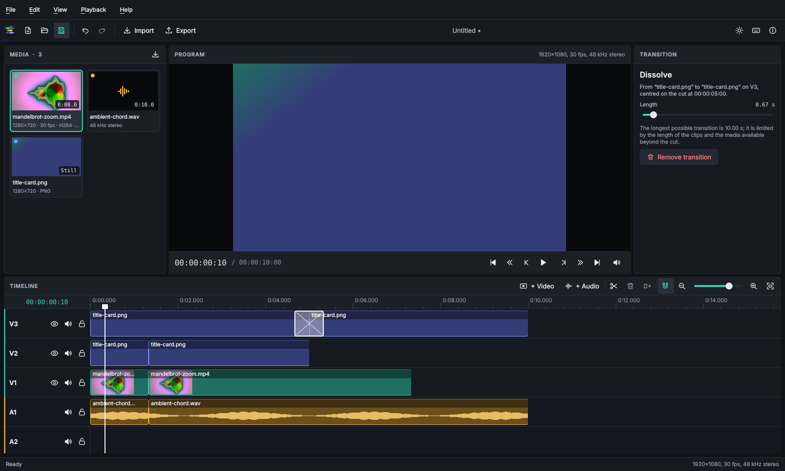

# FrameTrellis user guide

FrameTrellis is a local-first video editor: your media stays on your computer and is never
uploaded. This guide covers everything the current version can do.

- [Installing FrameTrellis](installation.md)
- [The workspace](#the-workspace)
- [Projects](#projects)
- [Importing media](#importing-media)
- [Editing on the timeline](#editing-on-the-timeline)
- [Batch editing and clip attributes](batch-editing.md)
- [Title overlays](#title-overlays)
- [Transitions](#transitions)
- [Adjusting clips](#adjusting-clips)
- [Volume keyframes (development preview)](#volume-keyframes-development-preview)
- [Opacity keyframes (development preview)](#opacity-keyframes-development-preview)
- [Transform animation (development preview)](#transform-animation-development-preview)
- [Subtitles (development preview)](#subtitles-development-preview)
- [Playback](#playback)
- [Exporting](#exporting)
- [Exporting an edit decision list (development preview)](#exporting-a-picture-edit-decision-list-development-preview)
- [Faster export profiles](faster-export.md)
- [Missing media and recovery](#missing-media-and-recovery)
- [Troubleshooting](#troubleshooting)
- [Keyboard shortcuts](keyboard-shortcuts.md)
- [Supported formats](formats.md)

## The workspace

| Area | Purpose |
|---|---|
| **Media** (left) | Files in the project. Drag a tile to the timeline or double-click it to append it. |
| **Program** (centre) | The edited sequence at the playhead, with transport controls and timecode. |
| **Clip / Project** (right) | Properties of the selected clip, or a project summary. |
| **Timeline** (bottom) | Tracks and clips. Video tracks (V1, V2…) are drawn bottom-up: V2 covers V1. Audio tracks (A1, A2…) are mixed together. |

Panels can be resized by dragging the gaps between them. *View* switches between dark and light
themes and between compact, normal and tall tracks.

## Projects

* **New project** (Ctrl+N): choose a name and a format (resolution and frame rate). The frame rate
  can only be changed while the timeline is empty; the export resolution can be chosen later.
* **Save** (Ctrl+S) writes a `.ftproj` file. Saving is atomic: if it fails (for example, the disk
  is full), the previous file is kept. FrameTrellis also refuses to save a project over
  a referenced source media file, including through an alternate path or symlink.
* **Open** (Ctrl+O) and *File → Open Recent* reopen projects. FrameTrellis asks before discarding
  unsaved changes.

Project files only reference your media; keep the media files when you move or share a project.
If you move the project folder together with the media, FrameTrellis finds them again.

## Importing media

In development builds with the **planned v1.4 folder import feature**, use
**File → Import Media Folder…** to select a directory. FrameTrellis searches
its subfolders for up to **500 supported media files** and imports them using
the normal background decoder checks. Files with unsupported suffixes and
symbolic-link file entries are ignored; directory symlinks are not traversed.
Files already in the media bin are skipped. A safety limit also stops discovery
after 10,000 scanned files, and large folders are reported as truncated.
No files are moved, copied, renamed or deleted. If the folder contains more
than the safety limit, split your import into smaller subfolders.

This is a **v1.4 development feature**, not included in the v1.3.1 stable
release. Folder discovery runs on a worker thread, keeping the editing workspace
responsive while scanning large or slow directories. The media-panel busy indicator
covers both folder discovery and background media probing. The scan result is
ignored if another project is opened before it finishes. Invalid or unreadable
folder errors appear when background discovery completes.

Use *File → Import Media…* (Ctrl+I), the import button on the media panel, or drop files from your
file manager onto the media panel or the timeline. Files are checked in the background: those
FFmpeg cannot decode are reported and not added. Importing a file that is already in the project
is ignored. Media identities are checked by canonical path, so a second name or relative-path
alias to the same file cannot create a duplicate entry. Relinking a media tile to a file already
used by another tile is rejected.

Supported: most video formats FFmpeg decodes (MP4, MOV, MKV, WebM, AVI, MTS, …), audio (WAV, MP3,
AAC/M4A, FLAC, Ogg, Opus, …) and still images (PNG, JPEG, BMP, GIF, TIFF, WebP and others your Qt
installation supports). Animated GIFs are treated as video. See [Supported formats](formats.md)
for the full list.

Right-click a tile to add it to the timeline, show it in its folder, relink it or remove it from
the project (removing never deletes the file; media in use must be removed from the timeline first).

For a cleaner media bin, **File → Remove Unused Media from Project** removes
imported media references that are not used by any timeline clip. Original
files remain unchanged on disk, and **Ctrl+Z** restores the removed references
in their original order. Media in use is always preserved. This is a
**v1.4 development feature**, not included in the v1.3.1 stable download.

Use the **Search media** field at the top of the media bin to find files by name or path,
without changing the project. The adjacent filter shows all assets, videos, audio,
still images or offline files. In development builds it also offers **Changed**
(sources modified since import), **Used** (referenced by timeline clips), and
**Unused** (not referenced by any timeline clip). Search is case-insensitive,
combines with the chosen category, and updates visible tiles when clip usage
changes. The **Unused** view lets you review media before choosing
**File → Remove Unused Media from Project**; filtering itself never removes
media or touches source files. Select **All** and clear the search box to see
every imported file again. Filtering never removes files from the project.

## Editing on the timeline

* **Add clips:** drag a tile onto a track (a ghost shows where it lands and turns red where it
  cannot go), or double-click a tile to append it to the first suitable track. Video and image
  files go on video tracks; audio files go on audio tracks. Video files with sound can also be
  placed on audio tracks to use only their sound.
* **Select:** click a clip; Ctrl+click adds to the selection. Click an empty part of a track to
  clear the selection and move the playhead.
* **Move:** drag a clip left/right or onto another track of the same kind. Moves that would
  overlap another clip are refused — nothing is ever overwritten.
* **Trim:** drag the left or right edge of a clip. You cannot trim beyond the start or end of the
  source media.
* **Slip (v1.4 development):** select one or more video or audio clips, then open
  *Edit → Slip Selected Clips (Source)*. Move source content one frame with
  **Ctrl+Alt+Left / Right**, or ten frames with **Ctrl+Alt+Shift+Left / Right**.
  The clip stays in the same timeline position and keeps the same duration,
  fades and effects; only its source in/out points change. Every selection
  slips atomically in one undo step. There must be available source material
  before/after the current source trim. Still images, locked tracks and slips
  that would remove a transition's source handles are rejected without edits.
  Trimming the end of a clip may create room to slip it later.
  This is not yet in the v1.3.0 stable release.
* **Roll a cut (v1.4 development):** select the outgoing clip (the one before a cut)
  and choose *Edit → Roll Cut After Selected Clip*. For a touching time-based clip,
  the inspector also offers **Roll Following Cut** controls. Rolling earlier shortens
  the outgoing clip and reveals more of the incoming source; rolling later does the
  opposite. The combined duration and surrounding timeline edges stay fixed.
  A roll preserves clip properties, fades and transitions and is undoable in one step.
  An invalid roll (exhausted source media, invalid fades or transition handles,
  separated clips, still images or a locked track) fails without changing either clip.
  This is not part of the stable v1.3.0 package.
* **Split:** move the playhead and press **S**. With clips selected, only those are split;
  otherwise every unlocked clip under the playhead is split.
* **Duplicate:** select one clip and press **Ctrl+D** (or use the timeline copy button). The copy
  retains its source trim and adjustments, and is appended to the end of the same track without
  moving other clips. Transitions are not copied; undo removes the duplicate in one step.
* **Delete:** **Delete** removes the selected clips and leaves a gap; **Shift+Delete** (ripple
  delete) removes one clip and moves the following clips on that track left to close the gap.
* **Snapping** (N) aligns clip edges with other clips and the playhead.
* **Zoom** with + and −, Ctrl+mouse wheel, the zoom slider, or *Fit* to see the whole sequence.
* **Zoom to Selection (v1.4 development):** select one or more clips and use
  *View → Zoom to Selection* (Ctrl+Shift+0), or the selection-fit toolbar button.
  FrameTrellis fits the selected clips' earliest start through their latest end,
  with a margin for trim handles. It never moves clips or changes project state.
* **Center on Playhead (v1.4 development):** use *View → Center on Playhead*
  (Ctrl+Shift+L) to return the horizontal timeline viewport to the current frame
  without seeking, stopping playback, or adding an undo entry. These view actions
  are not present in the published v1.3.1 stable release.
* **Go to timecode** with Ctrl+G (Playback menu): enter a frame-accurate timecode, such as
  `00:00:12:08`. Invalid or out-of-sequence positions are rejected without moving the playhead.
* **Duplicate a track (v1.4 development):** right-click a track header and choose
  *Duplicate track*. A separate track appears immediately after the original, keeping clip
  timing, source trims, settings and transitions but assigning new clip/transition IDs.
  Undo or redo this as a single edit. Not included in stable v1.3.1.
* **Tracks:** add tracks with *+ Video* / *+ Audio*; each track can be hidden (video), muted or
  locked. Double-click a track name to rename it. Right-click the track header
  to select all clips or remove an unlocked track. Development builds also offer
  **Move track up/down** in this menu for adjacent tracks of the same kind.
  Moving video tracks changes layer order; moving audio tracks changes mixer order.
  The move retains all clips, media and settings and supports undo/redo.
  In development builds, **Edit → Lock All Tracks** protects every track against
  accidental clip edits; **Edit → Unlock All Tracks** restores editability.
  Both are single-step undoable changes and preserve each track's mute and
  visibility settings. Not available in stable v1.3.1.

* **Advanced selections (v1.4 development):** **Ctrl+Shift+J** selects clips
  overlapping the playhead across all video and audio tracks; **Ctrl+Alt+R**
  selects every use of the single selected media source. Right-click a track
  header and choose **Select all clips on track** to select that track's clips.
  These commands can select locked tracks for inspection, but do not bypass
  lock protection on editing. If no clips match, the existing selection remains.
  Selection actions never change project edits or undo history and are not in
  the published v1.3.1 stable release.

Every change can be undone (Ctrl+Z) and redone (Ctrl+Shift+Z).

Clips on audio tracks show the waveform of their sound, scaled by the clip's volume. The first
time a file is used, FrameTrellis reads its sound in the background (a few seconds for a long
file) and keeps the result in its cache, so the waveform appears instantly afterwards.

## Volume keyframes (development preview)

This feature is a development candidate, **not part of the v1.3.0 Windows downloads**.
Select an audio clip or a video clip with audio, pause playback, and put the playhead
inside that clip. In the inspector's **Volume Keyframes** section:

1. Choose **Add point**. The new point starts at the currently interpolated level.
2. Adjust **Keyframe level** from -60 to +12 dB. Double-click the slider to return
   that point to 0 dB. A complete slider drag is one undo step.
3. Move the playhead and add more points. For music under dialogue, use four points:
   0 dB before the voice, -12 dB at the voice start, -12 dB at the voice end, and
   0 dB after the voice. Adjust the levels to suit the recording.
4. Use **Previous point** and **Next point** to navigate within the current trim.
   **Remove point** deletes the point at the playhead; **Clear all volume points**
   also clears points currently hidden outside the trim. All changes can be undone.

The timeline draws a volume envelope with diamonds at the actual keyframes. Levels
interpolate in decibels between points and hold at the first/last level outside them.
With no points, the envelope adds 0 dB. The curve combines with the existing **Volume**
slider and fades; clip and track mute still silence the clip. The waveform continues
to show source audio scaled by the overall Volume slider, with automation drawn over it.
Preview and MP4 export use the same envelope.

Points belong to the clip's **source frames** at the project frame rate. Moving or
duplicating a clip keeps its envelope. Trimming hides points without deleting them;
splitting copies the source envelope into both pieces. Slipping selects different
source frames and therefore reveals their corresponding levels. Transitions use the
same source envelope in their extra handles. Copy/paste of clip attributes changes
the existing scalar volume, mute, fades and picture settings; it leaves each
destination clip's automation unchanged.

**Compatibility:** Projects containing volume points save in project format **v3**.
Earlier development builds that only understand v2 cannot reopen them. Keep a backup
before upgrading. Projects without automation or subtitles save as v2; the reader
can load v1 through v6. Opacity curves require v4, transform curves v5 and subtitles v6. v1.3.0 stable cannot open these development formats.

## Opacity keyframes (development preview)

Select a video or still-image clip on a video track, pause playback, and place the
playhead inside the clip. Scroll to **Opacity Keyframes** in the inspector.

1. Choose **Add point**, then adjust **Keyframe opacity** from 0% to 100%. Zero
   reveals the tracks underneath; 100% applies no extra transparency. Double-click
   the slider to reset that point to 100%.
2. Move to another frame and add more points. For a gradual reveal, use 0% at the
   beginning and 100% later. Levels interpolate linearly between points and hold
   before the first and after the last point.
3. Use **Previous point**, **Next point**, **Remove point** or **Clear all opacity
   points**. Clear also removes points hidden outside the current trim. Every edit
   is undoable; a whole slider drag is one undo step.

Accent-colored squares show opacity points on the timeline. White diamonds show
volume points. Both curves stay visible and paint only the current viewport as
you zoom or scroll. Opacity multiplies the source's own transparency, the existing
clip **Opacity** slider and video fades. A transparent PNG keeps its transparent
regions. Opacity changes do not mute the clip's audio.

The curve uses the same source-frame anchoring as volume automation. Move, trim,
split, roll, slip and duplication preserve source-relative points. Image clips use
project frames as their source clock. Copy/paste of scalar attributes preserves
destination curves; **Reset Picture** clears picture adjustments, opacity
points and transform points together while retaining volume points, audio settings and fades.

Opacity points are dormant while a video source is on an audio track. Moving it
back to a video track restores the picture envelope. Audio-only sources cannot
have opacity points. Locked tracks prevent edits.

**Compatibility:** Opacity points require at least format **v4**; transform points
raise the saved format to **v5** and subtitles require **v6**. Volume-only projects
use v3 and projects without automation or subtitles use v2. Keep backup project copies before
switching development builds. This feature is not part of stable v1.3.0.

## Transform animation (development preview)

Select one video or image clip on a video track, pause playback and place the
playhead inside it. In **Transform**, adjust **Horizontal position**, **Vertical
position**, **Scale** or **Clockwise rotation**. Each change adds or updates a point
at that source frame. One point holds the same transform over the entire clip;
add points at other times to animate between different positions, sizes and angles.

- Position 0%, 0% centres the picture; +100% moves by one canvas width/height to
  the right/down. Position is limited to ±400% so a clip can move off-screen.
- Scale is uniform, from 1% to 1000%, with the source aspect ratio preserved.
- Rotation is clockwise around the picture centre, from -3600° to +3600°. Values
  interpolate directly: 0°→720° makes two full turns, while 350°→10° travels back
  through 180°. Enter the intended angles rather than relying on angle wrapping.
- Double-click a slider to restore that coordinate's neutral value at the playhead.
  Slider drags form one undo step. Keyboard arrows on a focused slider allow small
  changes at the specified step.

Enable **Show monitor handles** to move the selected clip by dragging its outline,
scale it with the lower-right square, or rotate it with the circular handle near
its top edge. The outline uses the actual monitor picture, excluding letterbox
margins. Each mouse drag is one undo step. The handles disappear while playing,
when the playhead leaves the clip, or when its track is locked. Use the inspector
or **Reset all transforms** to recover a picture moved completely outside the canvas.
The outline describes the fitted canvas, including transparent source regions.

**Add point** records the interpolated transform without moving the picture.
**Previous point** and **Next point** seek to points inside the current trim;
**Remove point** removes the current point. **Reset all transforms** clears the
whole curve, including hidden points, and restores centred, unrotated, 100% scale.
A `T · count` badge identifies transformed clips in the timeline. All actions are
undoable. Sound, fades, scalar picture settings and opacity automation are independent.
**Reset Picture** also removes transform and opacity curves, retaining audio/fades.

Points use source frames at the project rate. Move, trim, split, roll and duplicate
preserve the curve; slip exposes the transform at the newly selected source frames.
Endpoints hold outside the first/last point. Attribute paste leaves destination
curves intact. Picture curves are dormant when a video source is moved to an audio
track and resume when moved back. The same graph renders preview and MP4 output.

**Compatibility:** Any transform point requires project format **v5**, including
one constant point. Older builds refuse these projects. Loading v1–v6 is supported;
subtitles require v6. With no subtitles, clearing transform points permits v4/v3/v2
saves according to the remaining curves.
This feature is development work after stable v1.3.0. Keep backup project copies.

## Subtitles (development preview)

Open **File → Subtitles…**, the **Subtitles** toolbar button, or `Ctrl+Alt+S`.
Pause inside a free gap and choose **+ At playhead**, or **Import SRT…** to append
cues from a UTF-8 `.srt` file. An overlap refuses the entire import and preserves
existing cues. Use **Clear track** first to replace a track; clearing and importing
are separate undo steps. Touching cues are allowed, with only one cue active at once.

Select a cue to seek to its first visible frame. Edit its plain text and start/end
times in `HH:MM:SS,mmm` format, then choose **Apply cue** (`Ctrl+Return`). The end
is exclusive. **Use playhead** copies the current clock time into either field.
**Previous**, **Next**, **Preview cue** and the timeline subtitle strip navigate
the cues. The editor's applied preview shows the saved cue, so apply text changes
before reviewing them. On shorter windows, close the editor to see the program monitor.
Switching cues, importing, undoing or closing protects unapplied drafts with
Apply/Discard/Cancel. Saving the project applies a valid draft first. Project
**Undo/Redo** buttons are separate from text-field undo.

For subtitle/audio sync, use **Shift all cues**: move every cue earlier or later by
100 milliseconds or one second. Each click preserves the cue text, IDs, relative
spacing and duration; it is one undoable edit. Shifts that would move any cue
before time zero or beyond the maximum supported time are refused as a whole,
without a partial edit. This does not move video or audio clips, chapter
markers or the playhead. Shift operations are development-only (v1.4).

**Burn into preview and video** enables the same centered, bottom-aligned captions
in preview and MP4 export. Set text size from 2% to 10% of picture height and
toggle the dark background. Long text wraps and shrinks to fit; text remains
literal, including `<b>` tags. Install fonts for each language you use on every
rendering machine. Font substitution can change layout across operating systems.
Appearance changes, cue edits, import, removal and clearing are undoable.

**Export SRT…** saves every cue atomically, including cues beyond the video and
very short cues with no sampled video frame. It does not alter the project or
its history; SRT contains text and exact millisecond times, without styling.
Turn burn-in off for sidecar-only delivery. SRT export is separate from MP4 export;
the MP4 does not contain a switchable subtitle stream.

Times remain exact milliseconds at fractional frame rates; picture frames sample
those times, so a cue can begin on the next frame. Cues stay at their sequence
times when clips move, slip, split or ripple, and do not extend the video.
Review alignment after changing the edit. Cues outside the current video are
marked in the list and retained, with navigation disabled until they have a frame.
Input is limited to 8 MiB, 10,000 cues, 2,000 UTF-16 units per cue and 1,000,000
units total. Blank text lines separate cues in SRT and cannot be embedded in a cue.

**Compatibility:** Subtitles or nondefault subtitle styling require project
**format v6**. Older builds refuse these projects. Clear cues and **Reset style**
to return to the minimum format required by other features. Loading v1–v6 remains
supported. This workflow is outside the stable v1.3.0 downloads.

## Timeline markers (v1.4 development preview)

Use **Playback → Add Timeline Marker** (`Shift+M`) or the **+ Marker** button above the
timeline to attach a named review cue to an exact project frame. Markers are shown as diamonds
on the time ruler and remain visible as you zoom and scroll. Click one to seek to it;
double-click or right-click to open its editor. You can change its label or frame, or delete it.
Each change is undoable. Use `Ctrl+PageUp` and `Ctrl+PageDown` to jump to earlier/later markers.

To prepare video chapters for a description, add a first marker at frame **0**, then
place later markers at least one whole second apart. Use **Playback → Copy Markers as Video
Chapters** to copy lines in `HH:MM:SS Label` format. This uses the exact project frame rate
to convert frame positions into playback clock seconds, keeps Unicode names, and refuses
ambiguous timestamps. Paste the result into your video description, then review chapter
requirements for your publishing service. The action does not modify the project or files.

Markers are sequence-level notes: they do not change picture, sound, clip trims or export,
and they do **not** automatically follow clips moved by edits. The edit-point snapping
system also snaps clips to markers when snapping is on. Cues saved beyond the current end
of a shortened sequence remain in the project but cannot be navigated to until media again
covers their position.

**Compatibility:** Markers require project format v2; automation may require v3/v4/v5 and subtitles v6. FrameTrellis
v1.3 and older reject these newer project files, even if they contain no markers. Keep a
backup if you may need to return to an older editor. This feature is not in v1.3.0 stable.

### Export review markers as chapters

In this development build, choose **Playback → Copy Markers as Video Chapters** to
copy lines such as `00:01:05 Color grade` for a video description. The first
chapter must start at frame zero, and no two markers may map to the same whole second.
This action does not change the project or its edit history.

Choose **Playback → Copy Markers as WebVTT Chapters** for an HTML5 chapter track.
WebVTT chapter cues include frame-derived millisecond time boundaries, so they can
be used as chapter metadata in compatible web video players. The project must
contain a nonempty timeline, the first chapter must begin at frame zero, and all
chapter starts must precede the sequence end with strictly increasing frames.
Marker names are escaped as plain text, not interpreted as WebVTT markup.
Paste the copied output into a UTF-8 `.vtt` text file; attach it as a
`<track kind="chapters">` to a compatible HTML5 video player. This does not
burn anything into the exported video or upload data to any service.

Both chapter workflows are **v1.4 proposals**, not features of the v1.3.0
stable Windows package.

## Title overlays

Choose **File → Create Title…** after saving your project. Enter the text, choose a font size and
colour, and press **Create title**. FrameTrellis draws the text with a subtle shadow onto a
transparent PNG at the project's resolution. It stores that PNG in a **FrameTrellis Titles**
folder beside your `.ftproj` file and imports it as a normal image.

The title is initially placed at the end of the **uppermost unlocked video track**. Drag it to
the part of the sequence where it should appear, and trim its edges to control how long it is
visible. Keep titles on a track **above** footage you want visible behind the lettering.

These are **raster title overlays**, not editable text layers: create a new image if you need to
change the wording, font size or colour. Keep the title folder together with the project when
sharing it. Title creation currently supports dimensions up to 4096 × 4096 pixels.

## Transitions

A transition blends one clip into the next where they meet: a **dissolve** on video tracks and
a **crossfade** of the sound on every track.

1. Make sure the two clips touch: the second clip must start exactly where the first one ends
   (with snapping on, drag it until it snaps to the end of the first).
2. Select the first clip and press **T** (*Edit → Add Transition*), or choose *Add transition to
   next clip* in the inspector. The transition is one second long, or shorter if the media does
   not allow that.
3. Click the transition (the box with the bow tie over the cut) to select it. The inspector shows
   its length, which you can change with the slider, and a button to remove it. **Delete** also
   removes it.

A transition is centred on the cut, so both clips need unused media around it: the first clip
must continue after its end and the second must start earlier in its file. If a clip already
uses its whole file, trim it a little first. Still images can always be blended. Moving a clip
away from the cut or trimming it at the cut removes the transition; undo brings it back.

## Adjusting clips

Select one clip to see its properties:

* **Audio:** volume (−∞ to +12 dB) and mute.
* **Fades:** fade-in and fade-out length. Video fades reveal the track below (black on V1).
* **Picture:** opacity, brightness, contrast and saturation. Double-click a slider to reset it.
  Brightness, contrast and saturation need FFmpeg's `eq` filter; if your installation lacks it,
  the inspector says so.

Continuous slider changes become a single undo step.

## Playback

Space plays and pauses; Left/Right step one frame; Shift+Left/Right move one second; Up/Down jump
to the previous/next edit point; Home/End go to the start/end. Clicking or dragging on the ruler
moves the playhead. If no audio device is available, the preview plays silently.

## Media audit reports (planned v1.4 feature)

In development builds that include the v1.4 media-audit feature, choose
**File → Export Media Audit (JSON)…** to save a read-only report of the media
bin. It records the current file availability, size and modification-time
changes, clip-use counts and a [versioned schema](../architecture/media-audit-json.md)
(`schemaVersion: 1`).

The report never decodes, relocates, replaces or edits source files; it also
does not change project undo/dirty state. A file with the same byte count may
still be flagged as *changed* when its saved modification time differs. The
report does not calculate cryptographic checksums and is not a media-authenticity
guarantee. **Full local source-file paths are included** and may be sensitive:
inspect or redact the JSON before sharing it publicly.

This is a **proposed v1.4 feature**, not available in the current v1.3.0
stable download.

## Saving a preview snapshot (v1.4 development)

Use **File → Save Preview Frame as PNG…** when the program monitor has a decoded
frame. The snapshot uses the monitor's current preview resolution, which can be
smaller than the source or final video. The editor saves atomically and refuses
to replace a referenced source file or the open project. For full-quality
frames, use video export instead. This is not included in stable v1.3.1.

## Exporting

**File → Export Clip List (CSV)…** creates a read-only, UTF-8 CSV shot list
with track, source name/path, clip ID, frame positions, source trims and SMPTE
start/end timecodes. This report doesn't render video, edit the project or
change undo history. Save it only to a .csv file; the editor refuses to
replace imported source media or the project file. Spreadsheet formula-like
cells are escaped. **The CSV contains local file paths** — review it before
sharing outside your machine. Available in development source, not stable v1.3.1.

*File → Export…* (Ctrl+E):

1. Choose a preset (*Match project*, *1080p*, *720p*, *2160p*, *Fast draft*).
2. Choose where to save the `.mp4` file.
3. Optionally adjust quality (lower CRF = better quality, bigger file), encoder speed and audio.
4. Click **Export**.

The export runs in the background — you can keep editing; it uses a snapshot of the project.
The status bar shows progress. The result is written to a temporary file first and only replaces
an existing file once the export succeeded. FrameTrellis refuses to overwrite your source media
or the project file. Exports need all media to be available (relink offline files first).

Output: MP4 with H.264 video (yuv420p) and AAC audio, which plays almost everywhere.
For v1.2.2 and later, **Quick export** and **Turbo preview** optimize encoder speed.
Enable **Do not upscale smaller projects** to preserve native size instead of magnifying
small projects, and watch the measured frames/second in the export progress dialog.
See [Faster export](faster-export.md) for presets and tradeoffs.

## Exporting a picture edit decision list (development preview)

**File → Copy Picture EDL (CMX3600)** generates a cut-only picture edit
decision list and copies it to the clipboard. Paste it into a UTF-8 text file
with the `.edl` extension. An EDL describes source-in/source-out and
record-in/record-out SMPTE timecodes so an offline picture cut can be
conformed in another editing tool. Black gaps are represented explicitly as
`BL` events. Repeated uses of one source keep the same eight-character
reel identifier, with `* FROM CLIP NAME` and `* SOURCE FILE` comments
to help relink. Source file paths are metadata, not copies of your files.

The exporter deliberately **rejects** picture cuts that would misrepresent
the original timeline. There must be exactly one nonempty visible video
track; dissolve transitions, still-image clips, picture adjustments, fades,
and known source/sequence frame-rate mismatches are unsupported. Projects
must use 24, 25, 30, 23.976 or 29.97 fps. The output is limited to 999
events and 24-hour SMPTE timecodes. At 29.97 fps the exporter uses drop-frame
labels. Audio tracks and audio processing are **not represented**: this is
a *picture-only* EDL, not an audio conform, mix, or full project interchange.

EDLs cannot describe many effects, reel/timecode metadata and mixed-rate
workflows in a modern NLE. Review and verify the conformed sources in your
target editor. The export does not save over the project, change the timeline,
or render any media. **This is a v1.4 development feature, not part of
FrameTrellis v1.3.0 stable.**

## Missing media and recovery

If a media file was moved or deleted, its tile shows *Offline* and its clips show a red
placeholder. Right-click the tile and choose *Relink missing file…* to locate it. The replacement
must be the same kind of media and at least as long as the clips need.

When you choose **Edit → Check for Missing Media**, FrameTrellis also checks whether a media
file's size or recorded modification time changed since import. A changed source is flagged
in the media bin for review even if its file size is unchanged. This check does not edit
source files or mark the project as modified; changes made within one second may not be
detectable from filesystem timestamps alone.

FrameTrellis saves a backup of unsaved work every minute. If it closes unexpectedly, it offers to
recover that work the next time it starts.

## Troubleshooting

* **"The media engine could not start"** — the MLT modules were not found; reinstall FrameTrellis.
  Developers: see [building](../development/building.md#running-from-the-build-tree).
* **No sound** — check *Playback → Mute Preview* and your system's audio device. The speaker icon
  under the monitor is crossed out when no audio device is available.
* **A file is not supported** — the import message names the reason. Converting the file with
  FFmpeg (for example to H.264 MP4) usually helps.
* **Logs** — *Help → About → Open log folder*. *Copy diagnostics* copies version information for
  bug reports.

### Append a source excerpt (v1.4 development)

In the media bin, right-click an imported video or audio file and choose
**Append source excerpt…**. Enter the first source frame (**In**) and the
exclusive last boundary (**Out**) using the project frame rate. For example,
In 15 / Out 45 appends exactly 30 frames while retaining the original media
file, full source duration, and non-destructive project history. FrameTrellis
appends the excerpt to the first unlocked track compatible with the source and
selects it for further editing. Invalid ranges, still images, unavailable
sources and the absence of an editable track are refused.

Source ranges are expressed in **project frames**, not source-file timecode;
this feature does not yet provide a dedicated source playback monitor, proxy
generation, or synchronized automatic insertion of separate video/audio lanes.
It is in development only, not the published v1.3.1 stable release.

### Export a media audit as CSV (v1.4 development)

Choose **File → Export Media Audit (CSV)…** to save a read-only UTF-8 CSV
inventory of imported media. It includes asset IDs, names, media kind, online/
missing/changed status, timeline usage counts, stored/current file sizes,
original source paths and change reasons. It shares the JSON audit's status
calculation, uses CRLF records and escapes quotes, newlines and cells that
could otherwise be interpreted as spreadsheet formulas. The export is atomic
and refuses to overwrite a source file or the current project. It does not
probe or re-encode media, change clips or record an undo step. This feature is
in development, not in stable v1.3.1.
